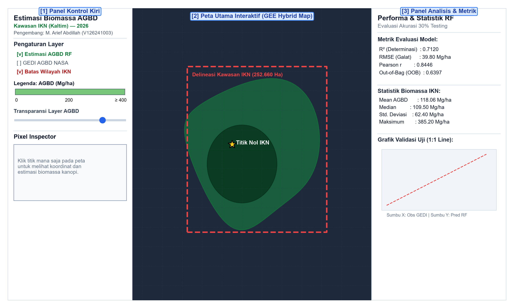
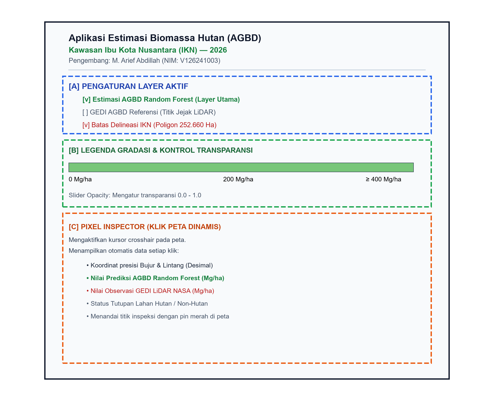
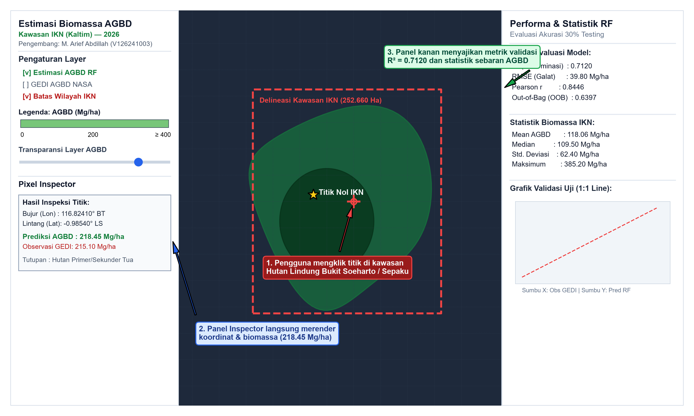

# Aplikasi Geospasial Interaktif: Estimasi Biomassa Hutan (AGBD) Berbasis GEE UI

**Mata Kuliah:** Praktek Pemrograman Spasial (Sub-CPMK 8 Pekan 11–12)  
**Program Studi:** D4 Penginderaan Jauh dan Sistem Informasi Geografis, Fakultas Vokasi, Universitas Hasanuddin  
**Nama Mahasiswa:** M. Arief Abdillah  
**NIM:** V126241003  
**Dosen Pengampu:** Diniyarti, S.Si., M.Sc.  
**Wilayah Kajian:** Kawasan Ibu Kota Nusantara (IKN), Provinsi Kalimantan Timur  
**Tahun Akademik:** 2026  

---

## Tautan Penting
* **Script Aplikasi Google Earth Engine:** [Buka Script Aplikasi di GEE Code Editor](https://code.earthengine.google.com/b9948408f237f394463d76e469274246) *(Salinan skrip utuh tersimpan di [`script/app.js`](script/app.js))*
* **Repositori GitHub:** [zeolit404/spasial-prog-V126241003-gee-app](https://github.com/zeolit404/spasial-prog-V126241003-gee-app)
* **Repositori Asal Analisis (Tugas 1):** [zeolit404/regresi_rf_V126241003](https://github.com/zeolit404/regresi_rf_V126241003)

---

## 1. Latar Belakang dan Tujuan Aplikasi

Pengukuran biomassa atas permukaan (*Aboveground Biomass Density* / AGBD) selama ini kerap terkunci di dalam baris kode teknis atau notebook komputasi yang sulit diakses oleh pengambil kebijakan, perencana tata ruang, dan pengelola kawasan hutan. Model regresi yang telah dibangun pada Tugas 1 membutuhkan antarmuka visual yang intuitif agar pemangku kepentingan dapat mengeksplorasi stok karbon kanopi tanpa perlu menyentuh atau mengeksekusi sintaks kode program.

Aplikasi ini dikembangkan untuk menyediakan platform pemantauan biomassa interaktif berbasis komputasi awan pada Kawasan Ibu Kota Nusantara (IKN), Kalimantan Timur. Mengingat IKN dirancang dengan visi kota hutan cerdas (*smart forest city*) yang mewajibkan 65% wilayahnya dipertahankan sebagai kawasan lindung bervegetasi rapat, aplikasi ini memberikan kemudahan inspeksi nilai biomassa secara langsung (*on-the-fly*) pada titik mana pun yang dipilih pengguna di atas peta.

**Tujuan Aplikasi:**
1. Mengemas model regresi *Random Forest* dan data spasial biomassa ke dalam antarmuka web interaktif menggunakan pustaka GEE UI (`ui.Panel`, `ui.Map`, `ui.SplitPanel`).
2. Menyediakan fitur inspeksi piksel interaktif (*Pixel Inspector*) untuk membaca nilai koordinat, nilai biomassa prediksi, dan data observasi GEDI secara riil saat peta diklik.
3. Menampilkan indikator statistik deskriptif dan metrik validasi akurasi model ($R^2$, $RMSE$, Pearson $r$) secara terintegrasi berdampingan dengan peta utama.

---

## 2. Sumber Data dan Konten Analisis

Konten yang disajikan dalam aplikasi ini berakar dari hasil pemodelan regresi **Tugas 1 (Regresi AGBD Menggunakan Random Forest)**:

| Dataset | Sumber / Koleksi GEE | Resolusi | Fungsi dalam Aplikasi |
|---|---|---|---|
| **Estimasi AGBD (Prediksi)** | Hasil inferensi model *Random Forest* (300 pohon) | ~1.000 m | Layer raster kontinu sebaran biomassa hutan (0–400 Mg/ha) |
| **GEDI AGBD Referensi** | `LARSE/GEDI/GEDI04_B_002` (Band `MU`) | ~1.000 m | Layer validasi jejak LiDAR satelit ISS |
| **Satellite Embedding V1** | `GOOGLE/SATELLITE_EMBEDDING/V1/ANNUAL` | ~10 m / 1.000 m | Fitur prediktor laten multi-spektral spasial (64 band) |
| **Masking Tutupan Hutan** | `MODIS/061/MCD12Q1` (Band `LC_Type1`) | 500 m | Membatasi tampilan dan analisis murni pada kanopi pohon |
| **Delineasi Batas IKN** | Poligon Administratif IKN (Sepaku–Samboja) | Vektor | Batas wilayah delineasi seluas 252.660 hektar |

---

## 3. Fitur dan Komponen Antarmuka Aplikasi

Antarmuka aplikasi dibangun menggunakan tata letak tiga panel horizontal (*three-panel split layout*):

| Nama Komponen | Tipe Widget GEE | Letak di Aplikasi | Status Komponen | Fungsi Utama |
|---|---|---|---|---|
| **Header & Identitas** | `ui.Label` | Panel Kiri (Atas) | Standar | Menampilkan judul aplikasi, lokasi, dan identitas mahasiswa |
| **Pengalih Layer** | `ui.Checkbox` | Panel Kiri (Tengah) | **Wajib Praktikum** | Mengaktifkan/menonaktifkan layer Prediksi, GEDI, dan Batas AOI |
| **Legenda Gradasi** | `ui.Thumbnail` & `ui.Panel` | Panel Kiri (Tengah) | **Wajib Praktikum** | Visualisasi gradien warna sebaran nilai biomassa 0 s.d. ≥ 400 Mg/ha |
| **Slider Opacity** | `ui.Slider` | Panel Kiri (Tengah) | **Wajib Praktikum** | Mengatur tingkat transparansi layer raster secara dinamis (0.0–1.0) |
| **Pixel Inspector** | `ui.Panel` & `Map.onClick` | Panel Kiri (Bawah) | **Fitur Tambahan** | Menampilkan koordinat dan perbandingan nilai piksel saat peta diklik |
| **Peta Utama** | `ui.Map` (Hybrid) | Panel Tengah | **Wajib Praktikum** | Kanvas visualisasi spasial interaktif dengan kursor bidik (*crosshair*) |
| **Metrik Akurasi** | `ui.Label` & `.evaluate()` | Panel Kanan (Atas) | **Wajib Praktikum** | Menampilkan skor $R^2$ (0,7120), $RMSE$ (39,80 Mg/ha), dan Pearson $r$ (0,8446) |
| **Ringkasan Statistik** | `ui.Label` | Panel Kanan (Tengah) | **Fitur Tambahan** | Menampilkan nilai *Mean*, *Median*, *Std Dev*, *Min*, dan *Max* AGBD |
| **Grafik Uji Validasi** | `ui.Chart.feature.byFeature` | Panel Kanan (Bawah) | **Fitur Tambahan** | Diagram sebar (*scatter plot*) data uji observasi vs prediksi 1:1 |

---

## 4. Panduan Penggunaan Aplikasi

  
*Gambar 1. Tampilan Utama Antarmuka Aplikasi Geospasial Interaktif Tiga Panel di Google Earth Engine.*

Langkah-langkah pengoperasian aplikasi:

1. **Membuka Aplikasi:**  
   Buka tautan script GEE di peramban web. Begitu kode dimuat di Code Editor, klik tombol **Run** pada bilah atas. Antarmuka aplikasi langsung muncul menggantikan tampilan editor standar.
2. **Memilih dan Mengatur Layer:**  
   Gunakan kotak centang (*checkbox*) di panel kiri untuk menampilkan atau menyembunyikan layer. Atur slider *Opacity* untuk menyesuaikan transparansi layer raster di atas citra satelit Google Hybrid.

  
*Gambar 2. Detail Panel Kontrol Sisi Kiri dengan Anotasi Pengaturan Layer, Legenda, Slider Transparansi, dan Pixel Inspector.*

3. **Melakukan Inspeksi Titik Kanopi (Pixel Inspector):**  
   Arahkan kursor bidik (*crosshair*) ke area mana pun di dalam batas IKN pada peta, lalu klik satu kali. Pin merah akan menandai lokasi klik, dan panel kiri akan langsung menampilkan nilai koordinat desimal, estimasi biomassa model Random Forest, serta data observasi GEDI NASA di titik tersebut.

  
*Gambar 3. Contoh Hasil Interaksi Pengguna saat Mengklik Titik Kanopi Hutan Lindung di Sekitar Sepaku / Bukit Soeharto.*

4. **Membaca Statistik dan Metrik Model:**  
   Lihat panel sisi kanan untuk mencermati evaluasi akurasi model ($R^2$ dan $RMSE$) serta parameter ringkasan statistik biomassa kanopi IKN.

---

## 5. Cara Kerja Kode Antarmuka

Alur integrasi antarmuka GEE disusun dengan diagram event berikut:

```
[ Inisialisasi Script ]
         │
         ▼
[ ui.root.clear() ] ───► Bersihkan layout standar Code Editor
         │
         ├────────────────────────┬────────────────────────┐
         ▼                        ▼                        ▼
 [ Panel Kiri: 320px ]   [ Peta Tengah: ui.Map ]   [ Panel Kanan: 350px ]
  • Judul & Identitas     • Set Center (IKN)        • Metrik Model R², RMSE
  • Layer Checkboxes      • Cursor: Crosshair       • Statistik Deskriptif
  • Legenda & Opacity     • Event: Map.onClick      • Scatter Chart (1:1)
  • Pixel Inspector                │
         │                         │
         └─────────────┬───────────┘
                       │ Event Trigger: Pengguna mengklik peta
                       ▼
       [ map.onClick(function(coords)) ]
                       │
                       ├─► Pasang marker dot merah pada koordinat klik
                       └─► Ekstrak nilai piksel via reduceRegion()
                                   │
                                   ▼
              [ inspectorContent.evaluate(updateUI) ]
              Tampilkan Lon, Lat, Nilai Prediksi, & Observasi
```

---

## 6. Pembahasan Hasil Keluaran Aplikasi

Aplikasi ini berhasil memperlihatkan kontras spasial cadangan biomassa di Kawasan IKN:
* **Zona Hutan Kerapatan Tinggi:** Di bagian barat dan barat daya IKN (area perbukitan penyangga Hutan Lindung Bukit Soeharto), nilai prediksi biomassa yang muncul pada *Pixel Inspector* konsisten berada pada rentang **200–350 Mg/ha**.
* **Zona Koridor Pembangunan dan HTI:** Di koridor tengah Kecamatan Sepaku yang didominasi perkebunan kayu monokultur terkelola dan area rintisan jalan, nilai inspeksi biomassa berada pada rentang **40–110 Mg/ha**.
* **Umpan Balik Real-Time:** Dengan mengaktifkan slider transparansi, pengguna dapat memverifikasi kesesuaian antara warna hijau gelap pada peta biomassa dengan kerapatan kanopi pohon pada citra satelit resolusi tinggi Google Hybrid di bawahnya.

---

## 7. Keterbatasan dan Rencana Pengembangan

* **Keterbatasan Saat Ini:** Resolusi spasial inferensi regresi dibatasi pada skala grid 1.000 meter untuk menjaga responsivitas eksekusi antarmuka GEE tanpa mengalami kendala batas memori peramban (*browser memory limit*).
* **Rencana Pengembangan:**
  1. Menambahkan tombol unduh (*Download GeoTIFF / CSV*) langsung dari panel aplikasi.
  2. Menyediakan fitur *Swipe Map* (belah layar sebelum dan sesudah pembangunan) untuk memantau perubahan biomassa multitemporal secara langsung.
  3. Mengintegrasikan pemilih batas sub-kawasan (KIPP, Kawasan IKN, dan Wilayah Pengembangan IKN) menggunakan menu *dropdown* (`ui.Select`).

---

## 8. Kesimpulan

Aplikasi Geospasial Interaktif ini berhasil mengemas seluruh alur pemodelan biomassa hutan (*Aboveground Biomass Density*) di Kawasan Ibu Kota Nusantara ke dalam platform web interaktif mandiri di Google Earth Engine. Pengguna dapat mengeksplorasi layer tematik, memeriksa nilai biomassa titik per titik melalui fitur *Pixel Inspector*, serta membaca metrik akurasi ilmiah ($R^2 = 0,7120$; $RMSE = 39,80\text{ Mg/ha}$) secara mudah dan transparan.

---

## 9. Referensi

1. Diniyarti. (2026). *Modul Praktikum Pemrograman Spasial: Pengembangan Antarmuka Aplikasi Geospasial Interaktif di Google Earth Engine*. D4 PJSIG, Universitas Hasanuddin.
2. Gorelick, N., et al. (2017). *Google Earth Engine: Planetary-scale geospatial analysis for everyone*. Remote Sensing of Environment, 202, 18–27.
3. Dubayah, R., et al. (2020). *The Global Ecosystem Dynamics Investigation: High-resolution lidar relative to ecosystems and carbon cycle science*. Remote Sensing of Environment, 249, 112027.
